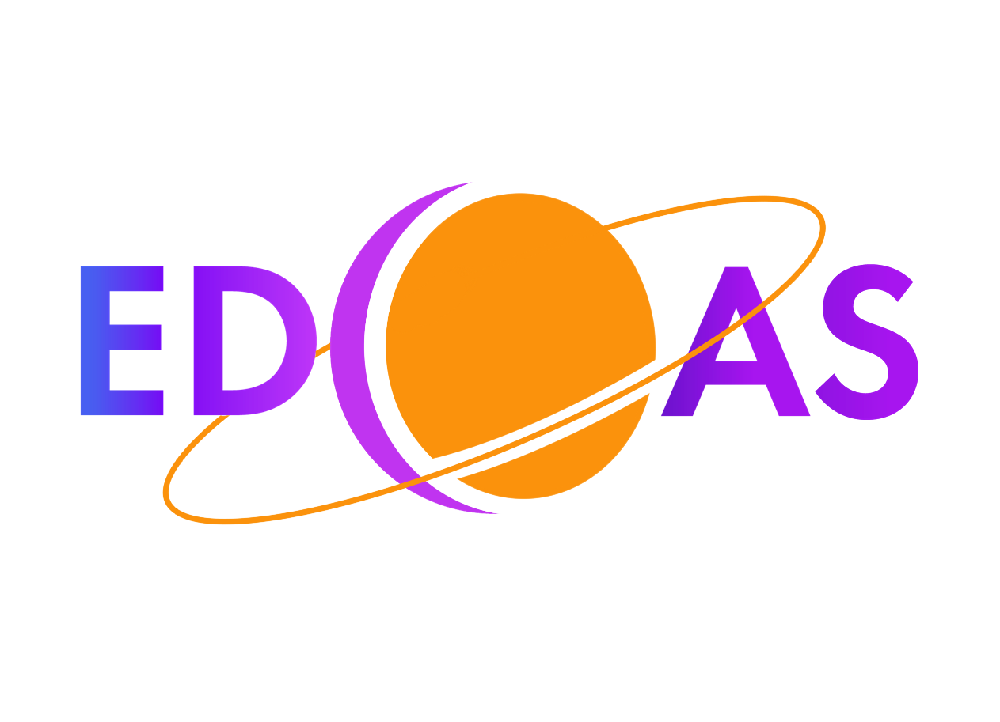

# EDCAS — Elite Dangerous Commander Assistant System

**This repository is used for issue tracking only.**

The development of EDCAS has moved to a private repository. The official
source code and ready-to-use builds of the client are available on the
EDCAS website.

[Website](https://edcas.de) · [Client downloads & source code](https://edcas.de/client)

## Downloads

Pick your platform on the [client page](https://edcas.de/client) — Linux,
Windows, Debian `.deb`, Arch `.pkg.tar.zst`, and the client source code
(`.tar.gz`, builds with `cargo`) are all provided there. Each download shows
its SHA-256 so you can verify what you install.

## Community & Support

* **Discord** — help with the install, bug reports, feature requests and news
  about every new build: [EDCAS Discord](https://discord.gg/T623MPQvja)
* **Ko-fi** — EDCAS is free and stays free; a coffee helps keep the servers
  running: [Support EDCAS on Ko-fi](https://ko-fi.com/cmdrfexx)

## Issues

Bugs and feature requests are still very welcome — please open a
[GitHub issue](https://github.com/arne-fuchs/edcas-client/issues) or bring
them to the [EDCAS Discord](https://discord.gg/T623MPQvja).

## Historical source code

The last publicly developed state of this codebase is preserved in the
[`archive/source-snapshot`](https://github.com/arne-fuchs/edcas-client/tree/archive/source-snapshot)
branch (tagged [`last-public-source`](https://github.com/arne-fuchs/edcas-client/releases/tag/last-public-source)).
It is kept for reference only and is no longer maintained here.

---

*Elite Dangerous is a trademark of Frontier Developments plc. This is an
unofficial, fan-made tool and is not affiliated with or endorsed by Frontier
Developments.*
